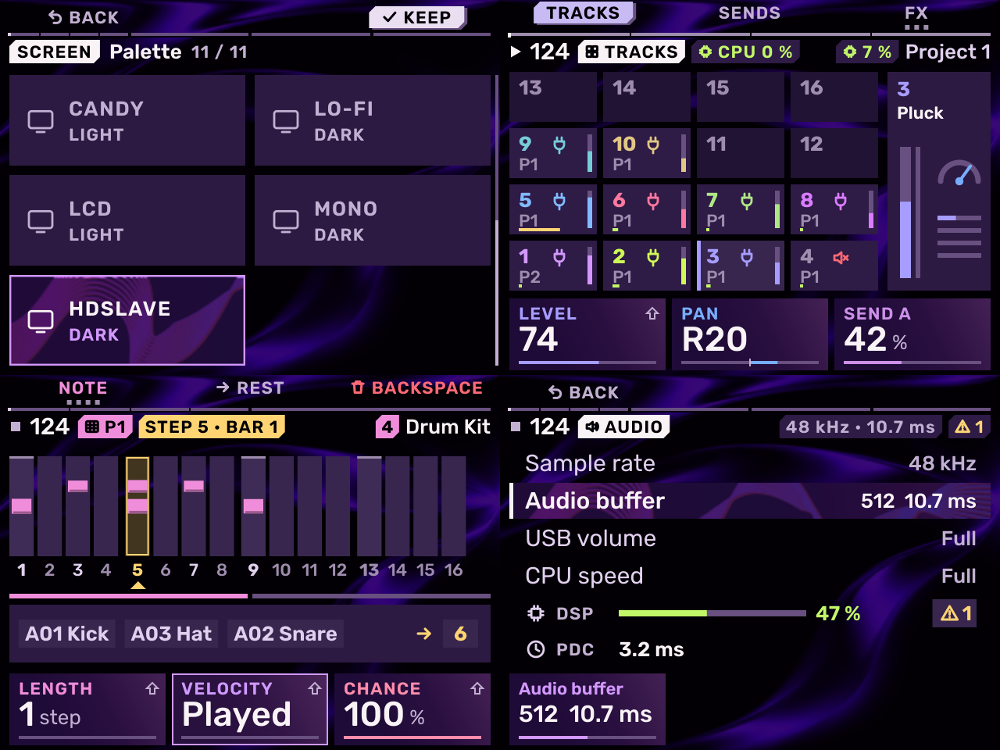
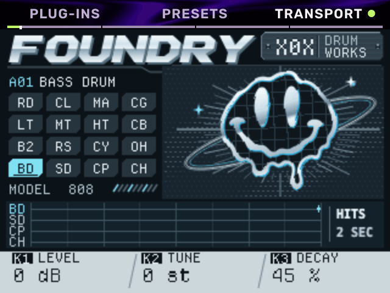
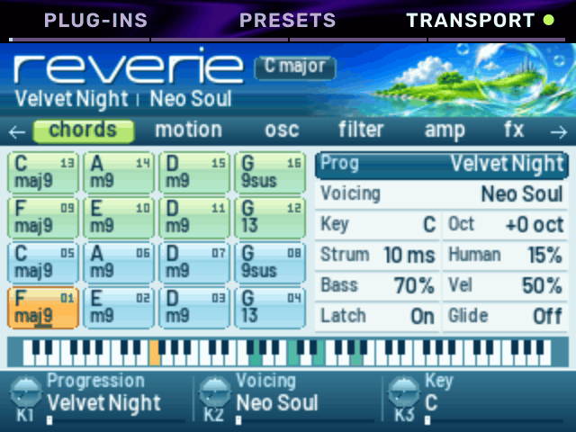
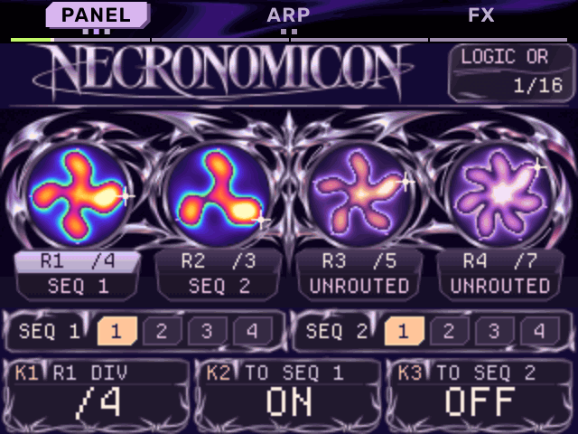
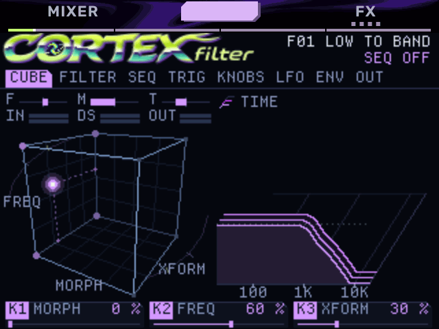
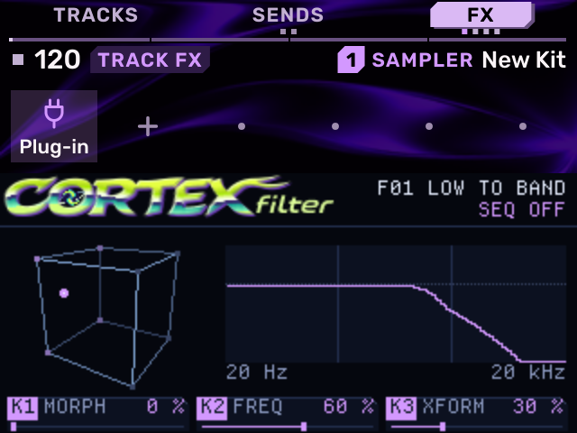
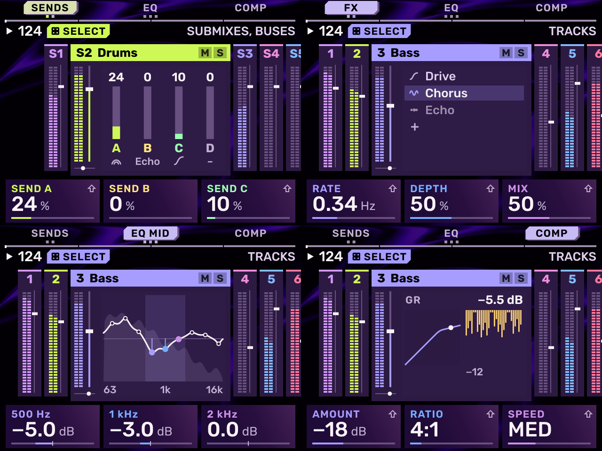
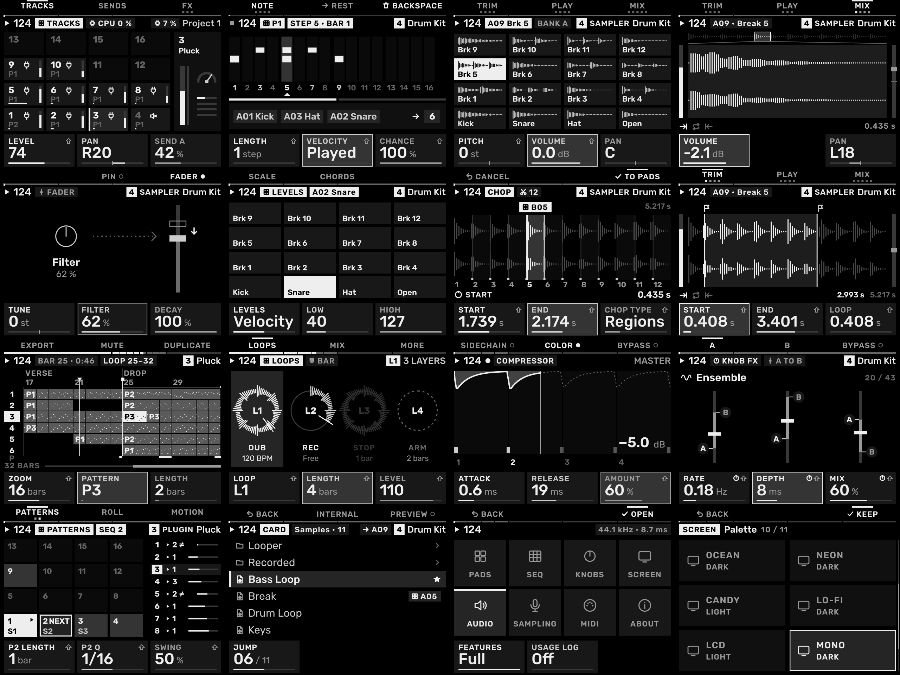

<h1 align="center">hdslaveOS</h1>

<p align="center"><strong>A techno OS for the Akai MPC Sample</strong><br>
Drum machines, acid bass and kick synths with their own screens, on a 16-track groovebox OS built on <a href="https://github.com/keremimo/melodee-sample">Melodee</a> by Kerem Kiliç (Ellic Studio). Currently on Melodee v0.9.1.</p>

<p align="center">
  <a href="https://github.com/hdslave/hdslaveOS/releases/latest"><b>Download</b></a> ·
  <a href="docs/QUICKSTART.md">Quickstart</a> ·
  <a href="docs/GUIDE.md">User guide</a> ·
  <a href="#the-instruments">The instruments</a>
</p>

<p align="center">
  
  <br><sub>The HDSLAVE palette on Palette, Mixer, Step Edit and Deep Freeze (hdslaveOS 0.8.1).</sub>
</p>

hdslaveOS runs on the MPC Sample in place of the stock app, started from the
microSD card. It does not change anything on the MPC itself: choose
**MPC APP** on its Exit screen, or remove its `autorun` folder from the card,
and the stock app runs as before.

It keeps everything Melodee does: 16 tracks, kits, sampling, plug-ins,
sequencing, Song, the looper and 41 effects
([the full list](#everything-melodee-does)). On top of that, hdslaveOS is set
up for making and playing techno.

## Built for techno

- **Eleven instruments and effects of its own.** The Complete SD Card Install
  comes with the hdslave plug-ins: a drum machine in the style of the
  808, 909 and 606, a kick synth, a 303-style acid bass with a generative
  sequencer, a percussion synth and a hand drum with step sequencers, a 3D
  morphing filter, and more. Each one draws its own hardware-style page on
  the MPC's screen. [The instruments](#the-instruments)
- **The kick drives the sidechain.** The master compressor's **Sidechain**
  can listen to a plug-in's second output. Foundry's **SC Key** bus carries
  its kick alone, so the mix ducks to the kick and nothing else.
- **Plug-in sequencers stay in time.** A plug-in that runs its own sequencer
  is woken when the transport starts or stops, is told when a song loops,
  and keeps its place while it sleeps or while its frozen track plays the
  print.
- **Headroom for stacked synths.** hdslaveOS removes idle and background work
  from the engine and the screen, and its audio stays bit-identical to
  Melodee's. **CPU speed** runs at Full unless you choose otherwise.
  **Display refresh** (a 20, 30 or 60 fps cap for built-in display updates),
  **Dim after** and **Pad brightness** save battery on a long set.
  [optimization.md](optimization.md) has the details.
- **Old projects find their files.** A project whose samples or plug-ins
  are no longer where it saved them (the card under another name, samples
  moved into `Melodee/Samples`, a project folder or plug-in moved) finds
  them and plays, instead of playing silent. What it cannot find at once, it
  offers to search the card for. [Moved files](docs/guide/projects-and-files.md#moved-files)
- **Freeze keeps the tails.** A printed track keeps its delay repeats, reverb
  tails and kit pad sends. Deep Freeze unloads the plug-ins too, and after a
  tempo change reloads them while the print plays.
- **Long patterns, quickly.** On **Step Edit**, **SHIFT + encoder** moves the
  caret a bar at a time, on the same step of the bar.
- **Your own synth presets.** **SHIFT + SAMPLE SELECT** saves a plug-in
  synth's sound as a user preset, and **PRESETS › User Presets** loads it in
  any project.
- **One channel per pad.** A MIDI track's **CHANNEL** can be **Multi**: each
  pad plays middle C on its own channel (pad 1 on channel 1, up to pad 16 on
  channel 16), with a step lane per pad. Use it for an external drum machine or a
  modular rig that takes one voice per channel.
- **A screen for a dark room.** Settings › **SCREEN** › **Palette** adds
  **HDSLAVE** (a static purple flare on black with dark violet contours on
  selected list rows, the default on new cards and on cards that used
  `NIGHT`) and **MONO** (high-contrast black and white), both with square
  corners. Kit pads light as vividly as the screen shows their colours.
- **Its own boot film**, the **hdslave intro**, in place of the default
  splash. The purple badge starts forming as the camera slides into place,
  then holds for a beat. The lower edge tears, tracking briefly settles, and
  the picture rolls once before the static breaks into a narrow strip and
  cuts to black. The interface fades in from there.

## The instruments

Eleven hdslave CLAP plug-ins come with the Complete SD Card Install, or on
their own from the
[hdslave MPC Sample Synths & Drum Machines](https://github.com/hdslave/hdslave-MPCSample-Synths-and-Drum-Machines)
collection. Each one draws its own interface on the MPC Sample through
Melodee's official `melodee.screen/1` extension.

<table>
  <tr>
    <td align="center" width="50%">
      <a href="https://github.com/hdslave/hdslave-Foundry-Drum-Machine"></a><br>
      <b><a href="https://github.com/hdslave/hdslave-Foundry-Drum-Machine">Foundry</a></b> — 16-voice 808/909/606-style drum machine
    </td>
    <td align="center" width="50%">
      <a href="https://github.com/hdslave/hdslave-MoonBass-Synth"></a><br>
      <b><a href="https://github.com/hdslave/hdslave-MoonBass-Synth">MoonBass</a></b> — kick drum synth
    </td>
  </tr>
  <tr>
    <td align="center" width="50%">
      <a href="https://github.com/hdslave/hdslave-Slink-Synth"></a><br>
      <b><a href="https://github.com/hdslave/hdslave-Slink-Synth">Slink</a></b> — 303-style acid bass with a generative sequencer
    </td>
    <td align="center" width="50%">
      <a href="https://github.com/hdslave/hdslave-Reverie-Synth"></a><br>
      <b><a href="https://github.com/hdslave/hdslave-Reverie-Synth">Reverie</a></b> — pad and chord synth: the pads play chord progressions
    </td>
  </tr>
  <tr>
    <td align="center" width="50%">
      <a href="https://github.com/hdslave/hdslave-Anvil-Synth"></a><br>
      <b><a href="https://github.com/hdslave/hdslave-Anvil-Synth">Anvil</a></b> — percussion synth with an 8-step sequencer
    </td>
    <td align="center" width="50%">
      <a href="https://github.com/hdslave/hdslave-Mystik-Synth"></a><br>
      <b><a href="https://github.com/hdslave/hdslave-Mystik-Synth">Mystik</a></b> — West Coast hand drum with a low-pass gate and a sequencer
    </td>
  </tr>
  <tr>
    <td align="center" width="50%">
      <a href="https://github.com/hdslave/hdslave-Machine"></a><br>
      <b><a href="https://github.com/hdslave/hdslave-Machine">Machine</a></b> — multi-machine synth: FM, drums and kits
    </td>
    <td align="center" width="50%">
      <a href="https://github.com/hdslave/hdslave-Psychic-Synth"></a><br>
      <b><a href="https://github.com/hdslave/hdslave-Psychic-Synth">Psychic</a></b> — generative synth with two corruptible sequencers
    </td>
  </tr>
  <tr>
    <td align="center" width="50%">
      <a href="https://github.com/hdslave/hdslave-Necronomicon-Synth"></a><br>
      <b><a href="https://github.com/hdslave/hdslave-Necronomicon-Synth">Necronomicon</a></b> — polyrhythmic subharmonic synth
    </td>
    <td align="center" width="50%">
      <a href="https://github.com/hdslave/hdslave-Nexus-Synth"></a><br>
      <b><a href="https://github.com/hdslave/hdslave-Nexus-Synth">Nexus</a></b> — multi-model macro oscillator synth
    </td>
  </tr>
  <tr>
    <td align="center" colspan="2">
      <a href="https://github.com/hdslave/hdslave-Cortex-Filter"></a><br>
      <b><a href="https://github.com/hdslave/hdslave-Cortex-Filter">Cortex Filter</a></b> — the effect: a stereo 3D morphing filter with a filter sequencer
    </td>
  </tr>
</table>

<p align="center">The <a href="https://github.com/hdslave/hdslave-MPCSample-Synths-and-Drum-Machines"><b>hdslave MPC Sample Synths &amp; Drum Machines</b></a> hub collects all eleven, with one download for the set.</p>

> **Desktop CLAP versions (macOS & Windows):** Each plug-in repository also includes a separate desktop CLAP build in its `mac-clap/` folder (for FL Studio and other desktop CLAP hosts) with all MPC screens on one interactive panel and MIDI Learn.

### Opening a plug-in screen

On an instrument track, press **B1** on Stage to move from **PRESETS** to **PANEL** and open the plug-in’s custom screen. **EDIT** shows Melodee’s parameter pages. In an FX chain, select Cortex Filter to see its compact view. Push the encoder to open the full panel. **B3** or **Shift + Push** returns to the chain, and **Shift + B3** opens the slot sheet.

On a plug-in panel, K1–K3 follow the knob takeover setting when you select another step or change which parameters a row controls.

<p align="center">
  
</p>

## On the screen

### Mixer

Mixer opens on the channel strips. Hold **+** to open the selected channel’s card and hold **−** to return to the strips. Tap **+** or **−** to move through the selected block.

<p align="center">
  
  <br><sub>Submix sends, insert effects, channel EQ, and compression.</sub>
</p>

### The MONO palette

<p align="center">
  
  <br><sub><b>MONO</b> — high-contrast black-and-white dark palette across 16 pages.</sub>
</p>

## Everything Melodee does

hdslaveOS keeps all of Melodee, the 16-track groovebox for the
**Akai MPC Sample** by Kerem Kiliç (Ellic Studio). Each pad is a
track: a drum kit, a keygroup (a sampled instrument), a plug-in instrument,
a MIDI track for external gear, or an audio track. Tracks play patterns,
patterns make sequences and a song, and every track has a mixer strip and an
effect chain that takes plug-in effects.

Back up your card before you install hdslaveOS.

New to hdslaveOS? Start with the [quickstart](docs/QUICKSTART.md). For every
page and control, read the [user guide](docs/GUIDE.md).

### Features

- **16 tracks**, one per pad. Hold **PAD BANK** and press a pad to select a
  track from any page.
- **VST3, LV2, CLAP and VST2 plug-in host**: load instruments and effects from
  the card. Use a plug-in instrument as a track's sound, and plug-in effects
  on track, bus, master and loop chains. Melodee runs 64-bit ARM Linux builds, Open
  MPC plug-ins, and 32-bit ARM plug-ins through a bridge. It loads each
  plug-in's presets, keeps its state in the project, plays drum machine
  plug-ins on pads, and compensates for plug-in latency.
- **Melodee synths**: three Open MPC instruments of its own, Melodee Poly
  (analog-style polysynth), Melodee PD (phase distortion) and Melodee Chip
  (chip voice), each with factory presets.
- **Kits** of 128 pads in 8 banks, with the stock Sample mode pages (Trim,
  Mix, Amp Env, Tune, Play, Filter, Filt Env) plus Layers, Follow (tempo
  follow), Cloud (granular) and a kit filter. Each pad has its own effects
  and sends to the four buses.
- **Sampling**: Chop (by hits, regions, beats, or by hand as the sample
  plays, up to 128 slices), Sample Record, Audio Recall, Resample and 16
  Levels.
  Samples load from WAV, MP3, FLAC, Ogg Vorbis and AIFF files. A sample
  longer than 10 seconds plays from the card, up to 6 hours; a project holds
  as many samples as fit in memory.
- **Stems**: separate a pad's sample into drums, bass, music and vocals on
  four new pads, on the MPC itself.
- **Sampled instruments**: SFZ, MPC keygroup and drum programs (`.xpm`,
  `.xty`), MPC expansions (`.xpn`), Logic EXS24 (`.exs`), SoundFont (`.sf2`)
  and DecentSampler (`.dspreset`), streamed from the card, on a keygroup
  track or a kit pad. Stock MPC Sample projects (`.xpj`) open too.
- **Auto sampler**: samples a plug-in track, or an external instrument on a
  MIDI track, into an MPC keygroup program on a new keygroup track.
- **Audio tracks**: record the input into a pattern, as on the MPC 3. Each
  take has its level, start and end, fades, reverse and warp.
- **MIDI tracks** for external synths and drum machines over USB-C or the
  MIDI jacks, with program changes, CC knobs and SysEx.
- **Chords**: MPC 3 chord progressions on the pads, on any track, and a
  chord builder for your own.
- **Sequencing**: 128 patterns per track in 8 banks, up to 128 bars each. Step
  sequencer, piano roll, step entry, parameter locks, ratchets and trig
  conditions. Sequences keep their own track mutes. Copy a sequence with its
  patterns, or use sequence chains and follow actions.
- **Song**: an arrangement with a lane per track, markers and a tempo lane.
  Export a WAV mixdown, stems, a MIDI file, an MPC 3 project or an Ableton
  Live Set.
- **Looper**: four loops that follow the tempo, with overdub and undo.
- **Effects**: 41 effects. A six-slot chain on every track, four send buses
  and the master. Knob FX, Pad FX, Flex Beat and the master compressor work
  as on the stock app.
- **Freeze**: print a track to audio and play it from the card, or deep
  freeze it to unload its plug-ins too. Ring prints keep delayed repeats, reverb
  tails and kit pad sends, and follow changes to plug-in tails. Long tails stream as they overlap
  across successive passes of a frozen pattern. Changing the selection keeps the previous freeze
  playable if the new selection exceeds the memory available. Deep Freeze preserves
  playback if a new print is incompatible with the handoff or relaunch tempo.
  A later tempo change automatically reloads the plug-ins while the original
  print plays, then returns the track to live playback on its next pattern pass.
- **Sync**: MIDI clock and MTC in and out, and CV clock out.
- **The Menu**: hold the encoder on any page for the page's jobs with their
  shortcuts, and the 16 places laid out as the pads. Four short **lessons**
  run on the MPC itself.
- **Basic and Full**: Basic shows the stock app's pages plus tracks,
  plug-ins, the mixer and Song. Full shows every page. Melodee starts on
  Full.
- **Web page**: connect the MPC to a computer by USB-C and open
  http://melodee.local to install plug-ins, manage the card's
  files and read this guide. The MPC can also show up as a USB webcam with
  Melodee's screen.

## Requirements

- Akai MPC Sample with firmware **1.3.0.12**, **1.4.0.7** or **1.4.0.8**. On any other
  firmware hdslaveOS does not start and the stock app keeps running.
- On firmware 1.4: **Developer Mode** on, in the stock app's Settings on the
  **DEV ENHANCEMENTS (BETA)** page.
- A microSD card.

## Install

Download the **Complete SD Card Install** for hdslaveOS and all eleven MPC
plug-ins, or the **OS-only** ZIP to update an existing install. Install
the unsigned ZIP by hand. [Latest hdslaveOS release](https://github.com/hdslave/hdslaveOS/releases/latest)

1. Back up the card, then extract the ZIP on your computer. With the
   complete installer, open `START-HERE.txt` and use the files inside
   `SD-Card/`.
2. On a direct-boot card, back up the existing top-level `autorun/` and
   `autorun.sh` and replace both with the copies from the ZIP. On a
   SampleBoot card, keep its launcher and copy the contents of the ZIP's
   `autorun/` into a new `autorun/mods/hdslaveOS <version>/` folder. Put
   `autorun.json` directly inside that folder.
3. If you downloaded the plug-ins, copy the supplied files into
   `Melodee/Plugins/hdslave/` on the card. Keep the supplied filenames so
   existing projects can find their plug-ins.
4. Start the MPC with the card inserted. On firmware 1.4, choose **Yes**
   at the autorun prompt. In SampleBoot, select the new hdslaveOS entry.

From hdslaveOS 0.9.1 on, the sequencer counts 960 ticks a quarter note, as
Melodee 0.9 does. Projects from earlier versions load with their timing
kept, but a project saved in 0.9.1 plays ten times too slow in hdslaveOS
0.8.3 and earlier. Back up `Melodee/Projects` before you update.

On firmware 1.4, Screen Mirror is not available and hdslaveOS runs at
44.1 kHz only: the firmware no longer lets apps load their own kernel
drivers, and its audio driver takes 44.1 kHz alone.

The [quickstart](docs/QUICKSTART.md) has the full steps, with screenshots.

### Plug-ins

Put plug-ins in `Melodee/Plugins` on the card (the `Plugins` folder inside
the `Melodee` folder at the top level), in any subfolders. hdslaveOS loads:

- VST3 bundles with a `Contents/aarch64-linux/` build
- LV2 bundles (`.lv2` folders) built for 64-bit ARM Linux (aarch64)
- CLAP plug-ins (`.clap` files) built for 64-bit ARM Linux (aarch64)
- [Open MPC](https://open-mpc.github.io) plug-in folders
- VST2 `.so` files built for 64-bit ARM (aarch64) or 32-bit ARM (armv7)

Plug-ins built only for Windows or macOS do not run on the MPC. The
plug-in picker shows them dimmed, with the reason.

The latest complete installer and the standalone collection contain the same
eleven MPC plug-ins. The included `MPC-PLUGINS.tsv` lists the exact source
revisions and file hashes. [Complete installer](https://github.com/hdslave/hdslaveOS/releases/latest) · [11-plug-in collection](https://github.com/hdslave/hdslave-MPCSample-Synths-and-Drum-Machines/releases/latest)

The installer includes **hdslave Slink 0.9.0**. Select Slink and open **Stage → Panel** to see its silver panel. [Standalone MPC download](https://github.com/hdslave/hdslave-Slink-Synth/releases/tag/v0.9.0) · [Slink 0.9.11 for freesp16, macOS and Windows](https://github.com/hdslave/hdslave-Slink-Synth/releases/tag/v0.9.11)
Keep the supplied `hdslave TB-MPC-3-P-0.clap` filename for saved projects.

<a href="https://github.com/hdslave/hdslave-Slink-Synth/blob/v0.9.0/docs/screen.md#silver-panel-on-mpc"></a>

The Melodee synths are free downloads:
[Melodee Poly](https://github.com/keremimo/mpc-vst-melodee-poly/releases/latest), [Melodee PD](https://github.com/keremimo/mpc-vst-melodee-pd/releases/latest) and
[Melodee Chip](https://github.com/keremimo/mpc-vst-melodee-chip/releases/latest). From each release, download the
`-mpc-sample.zip`, unzip it and copy the plug-in folder inside (for example
`Ellic Studio - VST - Melodee Poly`) into `Melodee/Plugins`. The synths also run on
MPC OS devices that load Open MPC plug-ins; those devices use the
`-mpc-aarch64.zip` or `-mpc-armv7.zip`.

## Documentation

| Document | What it covers |
| --- | --- |
| [Quickstart](docs/QUICKSTART.md) | Install, first start, a first beat, saving |
| [User guide](docs/GUIDE.md) | Every page and control, and a chapter for users of the stock app |
| [Reference](docs/MELODEE.md) | The complete control reference, file formats and internals |

The design notes for the [Looper](docs/LOOPER.md) and
[MIDI tracks](docs/MIDI_TRACKS.md) record the choices made while each was
built. They are for developers; the user guide covers both.

## Build from source

hdslaveOS is built for linux/arm64 in a Docker image. You need Docker and
Python 3.

```sh
git clone --recurse-submodules -b hdslave https://github.com/hdslave/hdslaveOS.git
cd hdslaveOS
./build.sh
```

To make an unsigned package from a committed tree, build with the version,
strip as `release.sh` does, and package (`release.sh` itself makes Melodee's
signed releases and needs its author's key):

```sh
MELODEE_VERSION=v0.9.1-hdslave.1 ./build.sh
docker run --rm --platform linux/arm64 -v "$PWD:/work" sample-base-builder \
    sh -c 'strip -o build/melodee.release build/melodee && build/melodee.release --self-test build/release-test.wav'
python3 tools/package_unsigned.py v0.9.1-hdslave.1
```

This writes `dist/hdslaveOS-MPC-Sample-<version>-unsigned.zip`.

`./build.sh` builds `build/melodee`, then runs the tests, a sound
self-test, a monkey test and the page previews (`build/melodee-preview/`).

| Path | Contents |
| --- | --- |
| `src/melodee/` | The app: pages, shell, plug-in hosts, design system |
| `src/main.cpp` | Connects Melodee to the sample-base runtime |
| `base/` | [sample-base](https://github.com/keremimo/sample-base) (git submodule): drivers, runtime, build, install scripts |
| `core/` | [ellic-core](https://github.com/keremimo/ellic-core) (git submodule): the engine, model and shared files, with hdslaveOS's engine changes |
| `tests/` | Engine, sequencer and shell tests, layout and release checks |
| `tools/make_release.py`, `release/` | The SD card release zip |

To run a build on an MPC over SSH, use `device.py` (the base's device tool):

```sh
python3 device.py start
```

`start` copies Melodee into RAM and starts it. `status`, `ctl` and
`screenshot` talk to the running app. `install-sd` starts it from the card at
every boot.

Melodee's signed release zip (`./release.sh VERSION`,
`dist/Melodee-MPC-Sample-<version>.zip`) needs its author's key; hdslaveOS
makes the unsigned package above instead.

To move the base and the core to their latest commits (hdslaveOS uses the
`hdslave` branches of [hdslave/sample-base](https://github.com/hdslave/sample-base),
whose `main` lacks hdslaveOS's CPU-speed commits, and of
[hdslave/ellic-core](https://github.com/hdslave/ellic-core), which carries
hdslaveOS's engine changes):

```sh
git -C base pull origin hdslave
git -C core pull origin hdslave
git add base core
```

## Support

Report a problem with hdslaveOS in this repository's
[issues](https://github.com/hdslave/hdslaveOS/issues), and a problem with an
hdslave plug-in in that plug-in's repository. Please don't report them to
Melodee.

Melodee is free. If you use hdslaveOS, you can support Melodee's author on
[Ko-fi](https://ko-fi.com/keremimo).

## Credits and licence

hdslaveOS is made by hdslave. It is built on Melodee, which is made by
Kerem Kiliç (Ellic Studio). hdslaveOS is an independent project: Ellic Studio
does not make or support it.

Melodee and hdslaveOS are licensed under AGPL-3.0-only ([LICENSE](LICENSE)).
They use JUCE under the AGPLv3, and the Rubik typeface and the other screen
fonts under the SIL Open Font License 1.1 ([THIRD_PARTY.md](THIRD_PARTY.md)).
hdslaveOS's boot film, the hdslave intro, is not covered by the AGPL (all
rights reserved); it replaces Melodee's own boot art.

Neither Melodee nor hdslaveOS is affiliated with or endorsed by inMusic or
Akai Professional. MPC and MPC Sample are trademarks of inMusic Brands.

## hdslave plug-in license

You may use these plug-ins to make, perform, record and sell music, including paid client work, without royalties or credit to hdslave. You may share complete, unchanged official releases for free with their notices intact. Selling the software, including it in a paid product or subscription, or distributing a modified version requires prior written permission from hdslave. Third-party components keep their own licenses. [Full plug-in license](LICENSE-hdslave-plugins.txt).
