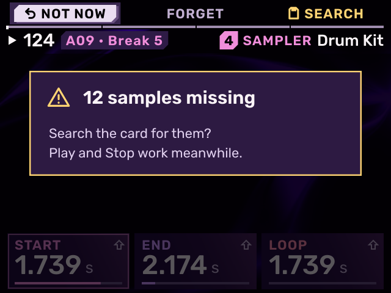
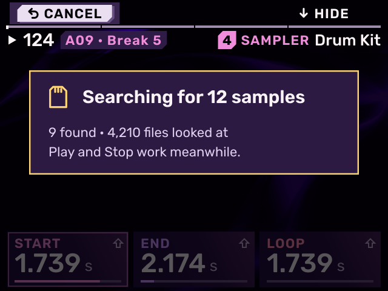

# Projects and files

Previous: [MIDI and sync](midi-and-sync.md) · [Contents](../GUIDE.md) · Next: [Settings](settings.md)

## The Project page

Press **SHIFT** + **Pad 16**.

- **B1** (**SAVE AS**): save the project under a new name. The old file
  stays as it was.
- **B2** (**OPEN**): the list of projects.
- **B3** (**NEW**): start a new project (asks first). The question says
  whether the open project is saved first or its changes are lost.
  **B3** (**NEW**) starts it with no tracks and opens the track types on
  track 1. **B2** (**KIT**) starts it with one of the MPC's factory kits on
  track 1, so the pads play at once. **B1** cancels.

Or turn the encoder to pick one and push it.

### Saving

Melodee saves the project in the background, as the stock app does. Three
seconds after you last used a control it writes the project to its file, as
long as nothing plays, records or prints. A new project gets a file of its
own the first time: **Project 1**, **Project 2** and so on.

- The Project page shows **SAVED**, or **UNSAVED** until the next save.
- While the sequencer plays, nothing is saved. Stop, and the save follows.
- An MPC project you open is not saved in the background. Press **B1**
  (**SAVE AS**) to give it a file of its own.
- The Exit screen saves before it powers off or leaves.
- Undo and redo are not saved with the project.
- To keep an earlier state, press **B1** (**SAVE AS**) before you go on.

To save only when you choose, turn **Autosave** off in
[Settings](settings.md) (**SEQ**). Then:

- **B1** reads **SAVE** and writes the project to its file. A project
  with no file yet still gets **SAVE AS**.
- **SHIFT** + **B1** (**SAVE AS**) saves it under a new name.
- To go back to what was last saved, open the list, push the open project
  and pick **REVERT** (**TO SAVED**). Push it again to confirm.
- **NEW**, **LOAD** of another project and the Exit screen don't save.
  While the project has changes they say **DISCARDS** (**LOAD**: **CHANGES
  LOST**), and **LOAD** asks once more.

The header shows **UNSAVED** in amber while the project has changes.

A sample's chop is saved in the sample's WAV file, as the MPC saves slices:
the slices, the chop type and the cuts made by hand. The chop comes back
with the sample in any project.

In the list:

- Turn the encoder to move. **K1** jumps, **K2** sorts.
- Push the encoder or press **B3** to open a folder. **B1** goes back.
  At the top of `Melodee/Projects`, **B1** goes up to the card's own folders,
  so a project or kit anywhere on the card can be loaded. At the card's top,
  **B1** closes the list.
- **B2** switches between the card and the MPC's internal drive
  (**INTERNAL**). The internal drive holds the stock app's projects, its
  **Autosave**, and the factory **Demos** and **Kits**. It is read only:
  its projects have Load and Load kit.
- The list opens on the open project the first time, then where you left
  it. A project not yet saved on the card opens it at the card's top. Each
  drive keeps its own folder and row.
- Push the encoder or press **B3** on a project to open its sheet. Its jobs
  are cards. The open project has Save, Save as new, Rename, Duplicate,
  Move to folder, New folder here, Open at start and Delete. Another
  project has Load and **Load kit** (no patterns) first, which loads its
  first kit onto the selected track.
- Save (or Load) is picked when the sheet opens. Turn the encoder to pick
  another card and push it. **B1** closes the sheet. Delete says **PRESS
  AGAIN**: push once more to delete.
- **ERASE** on a project opens its sheet on Delete. Press **ERASE** again
  to delete it. **SHIFT** + **ERASE** duplicates it.

While a project loads, a Loading sheet shows its progress. The audio fades
out and back in.

## Naming

The Name sheet opens when you save or rename a project, sample, sound, bank,
marker, sequence or track.

- The pads type like phone keys. Each pad shows the letter it types next.
  Pad 14 types a space, pad 15 switches to digits, pad 16 deletes.
- Turn the encoder to move the cursor. **K1** chooses a suggested name.
- **K2**, or **SHIFT** + encoder, changes the character under the cursor.
- **ERASE** deletes. **SHIFT** + **ERASE** clears the name.
- **B2** switches between capitals and lower case.
- **B3** (**SAVE**) or encoder push saves. **B1** cancels.

## MPC Sample projects

Melodee opens stock MPC Sample projects (`.xpj`), wherever they are on the
card. When the card has the stock app's `MPC-Sample/Projects` folder, the
project list shows it as the **MPC Sample** folder. Press **B2**
(**INTERNAL**) for the projects on the MPC's internal drive, with the
factory demos and kits.

Their sheet has Load and Load kit. Load opens a copy. The stock project is
not changed. **SAVE AS** on the Project page makes a Melodee project
(`.mldp`) that plays the samples from where they are.

- Each Drum track becomes a kit track. Each sequence becomes that numbered
  pattern, with its tempo. A sequence's name becomes its name on
  **Sequences** (a default name, such as *Sequence 01*, stays blank).
- The song becomes **Song** (see [Song](song.md)):
  - Each step becomes a clip on each track that has notes in its sequence.
    A track with no notes in that sequence gets no clip there.
  - A clip is as long as the sequence times its repeats. The steps follow
    one another from bar 1.
  - Each step has a marker with its sequence's name, or **SEQ** and its
    number.
  - When the sequences have their own tempos, the tempo lane changes the
    tempo where a step's tempo differs from the step before. With one
    global tempo, or **Ignore Tempo** on, the song has no tempo lane.
  - Melodee has one song. When the project has more than one song with
    steps, the first opens. The message after loading says when something
    was left out.
- MPC 3 projects open the same way. Their Keygroup tracks become keygroup
  tracks, and their Audio tracks become audio tracks (see
  [Audio tracks](audio-tracks.md)).
- Carried over: pad regions, tune, volume, pan, play type, mono, mute
  group, envelope, loop, Warp, filter, and pads with several layers.
- Not carried over: Pad FX, insert effects and sends.

## A new card

A project plays its samples from where they are on the card. It keeps no
copies. To move to a new card, copy the folders from the old card to the new
one with the same names, for example `Melodee/Projects`, `Melodee/Samples`
and `Melodee/Plugins`. Projects and bank files then find their samples and
plug-ins at the same place on the new card.

## SD card access

Connect the MPC to a computer to copy files to and from the card, without
taking it out.

1. Connect the MPC to the computer with a USB-C cable.
2. Open the project list (**SHIFT** + **Pad 16**, **B2**) and push the
   encoder on **SD card access** at the top.
3. The card appears on the computer as a drive. Copy your files.
4. Eject the drive on the computer.
5. Press **B1** (**EJECT**). Melodee reads the card again.

## File sharing

While Melodee runs, a computer connected with USB-C can also open the card
as a network drive. Melodee keeps working and keeps the card.

1. Connect the MPC to the computer with a USB-C cable.
2. On a Mac, choose **Melodee** under **Network** in the Finder sidebar,
   or choose **Go** > **Connect to Server** and enter
   **smb://melodee.local**. On Windows, open `\\192.168.155.1` in File
   Explorer.
3. Connect as **Guest**, or enter any name with an empty password.
4. Open **SD Card**. Copy your files.
5. Eject **SD Card** on the computer when you are done.

File sharing is on until you turn it off in **SETTINGS** > **AUDIO** >
**File sharing**. While the computer has **SD Card** open, SD card access
does not start; eject it on the computer first. File sharing needs MPC
firmware 1.3.0.12; on firmware 1.4 it does not start.

While the card is mounted on the computer, the pads still play the selected
track, and **PLAY**, **STOP** and **MAIN VOLUME** still work. The other
controls wait. USB audio and USB MIDI keep working. If you press **B1**
before you eject the drive, the page shows **STILL MOUNTED**. Press **B1**
again and Melodee asks whether to eject anyway.

## Files on the card

| Folder | Contents |
| --- | --- |
| `autorun/` | Melodee itself. Do not change it. |
| `Melodee/Samples/` | Your samples. Melodee writes `Recorded/`, `Edits/`, `Banks/`, `Looper/`, `Expansions/`, `Keygroups/` (auto sampled programs) and `Stems/` (a sample's stems) here. |
| `Melodee/Projects/` | Projects (`.mldp`), and each project's `Loops`, `Prints` and `Audio` folders |
| `Melodee/Mixdowns/` | Song mixdowns |
| `Melodee/Stems/` | A song's stems |
| `Melodee/MIDI/` | Exported MIDI files |
| `Melodee/MPC 3/` | MPC 3 projects exported from Song |
| `Melodee/Ableton/` | Ableton Live Sets exported from Song, a folder each |
| `Melodee/Progressions/` | Chord progressions you make |
| `Melodee/Sounds/` | Sounds you save |
| `Melodee/Cache/` | Decoded instrument samples, and long MP3, FLAC, Ogg and AIFF samples as WAV. Safe to delete: Melodee makes them again. |
| `Melodee/Plugins/` | VST3, LV2, CLAP and VST2 plug-ins |
| `Melodee/Plugin Data/` | Plug-in settings and presets |
| `Melodee/Crashes/` | Crash reports, one file a crash (see [Troubleshooting](exit-and-troubleshooting.md#troubleshooting)) |
| `Melodee/SysEx/` | `.syx` files for MIDI tracks |
| `Melodee/settings` | Melodee's settings |

Melodee makes no other folders at the top of the card. `Samples/` and
`SysEx/` there, where older versions kept them, are still read. Move what
is in `Samples/` into `Melodee/Samples`, and projects find their samples in
the new place.

## Moved files

A project remembers where each of its samples and plug-ins was. When a file
is no longer there, hdslaveOS looks for it. The project opens and plays at
once with every file that is in place. A kit you load with Load Kit or a
bank you load with Load Bank is looked for the same way.

It finds these by itself, without asking:

- the same card under another name;
- a project folder moved with its samples;
- a stock project's sample whose name has no extension;
- the rest of a kit, once one of its samples was found in a new folder;
- a plug-in moved to another folder in `Melodee/Plugins` (when the project
  knows which plug-in of a file it used, only a file that holds it).

When samples are still missing, it asks:

- **B1** (**NOT NOW**) leaves them. **SAMPLES** shows **NOT FOUND**, and the
  next time you open the project it asks again.
- **B2** (**FORGET**) is for samples you deleted. They are taken off their
  pads, and the project stops asking. Undo brings them back.
- **B3** (**SEARCH**) looks through the whole card, then the internal
  sample folders, by name.

While it searches, the project keeps playing. The samples it finds load
when it has looked everywhere. **B3** (**HIDE**) puts the sheet away: the
search goes on and a message says what it found. If another question comes
up over it, the search's sheet comes back when that one closes.

**B1** (**CANCEL**) stops the search, and the message says **Search
stopped**. A file it found by then loads only when it is plainly the one:
in a folder of the same name as before, or in the project's own folder. The
rest stay missing, not searched: **FIND MISSING** searches again.

- When several files have the same name, the one in the folders most like
  the saved path wins. Files of the same name are taken only when they are
  copies of one file; when they differ, the sample stays missing.
- The first search takes a while on a full card. Later searches, in this
  project or another, answer at once until you turn the MPC off, take the
  card out, use SD card access or send a file from the web page.
- A card with more than 200,000 samples is searched only that far, as a
  cancelled search is, and the message says **Card too big to search** (or
  how many it found). It is not searched again until the card changes.
  Folders more than twelve deep are left out.
- If the card cannot be read during a search (it was taken out), the
  message says **Card could not be read**, and nothing is called missing.
- Found files are saved with the project the next time it is saved.
  Opening a project changes nothing on the card. A stock project's sample
  found later plays its pads' regions at that file's own sample rate.
- On **SAMPLES**, **SHIFT** + **B1** (**FIND MISSING**) searches again, for
  example after you copied files back. **SHIFT** + **B2** (**FORGET**)
  forgets what is still missing. While a search runs, **SHIFT** + **B1** is
  **CANCEL**.
- **SETTINGS** > **SEQ** > **Find moved files** sets what happens: **Ask**
  (the question), **Always** (it searches without asking) or **Off** (no
  question and no search, only a message with how many samples are
  missing). Off still finds what needs no search (the list above), and
  **FIND MISSING** still searches.
- SD card access stops a search; it starts again when you ask.
- A plug-in that is not found shows **Plug-in missing** and its name, or how
  many when several are missing. A project file that cannot be read shows
  **Could not open** and its name.

## The web page

While Melodee runs, connect the MPC to a computer with USB-C and open
**http://melodee.local** (or **http://192.168.155.1**) in a browser. It has
four tabs:

- **Device**: the version running, the card's free space and the plug-ins
  in `Melodee/Plugins`. Drop a plug-in's `-mpc-sample.zip` on **Plug-ins**
  and press **Install** (see
  [What runs](plug-ins.md#what-runs)).
- **Files**: the folders on the card. Play audio files in the browser,
  download files, upload files (with **Upload** or by dropping them on the
  list), make folders and delete files or folders. The browser asks before
  it deletes. An upload never replaces a file of the same name. The
  `autorun` folder is not shown.
- **Quickstart** and **Manual**: the quickstart and this guide. They work
  without an internet connection.

Uploads wait while the card is on a computer with SD card access. When
Melodee stops, the MPC's own web page comes back.

## Update hdslaveOS

Install the unsigned release ZIP by hand. Download the **OS-only** ZIP
to update the OS, or the **Complete SD Card Install** to update the OS
and all eleven hdslave plug-ins together. [Latest hdslaveOS release](https://github.com/hdslave/hdslaveOS/releases/latest)

1. Save your project, exit to the stock app, and power off. Back up the card
   on your computer and extract the ZIP.
2. On a direct-boot card, replace the top-level `autorun/` and
   `autorun.sh` together. On a SampleBoot card, use a new version folder in
   `autorun/mods/` and keep SampleBoot's launcher. Follow the
   [installation layout](../QUICKSTART.md#1-install).
3. If updating the plug-ins too, copy the files into
   `Melodee/Plugins/hdslave/` and keep their filenames. Projects, samples
   and settings are in the card's `Melodee/` folder.
4. Boot the new version. To check the build on the MPC, open **Settings →
   ABOUT** and press **B3**.

---

Previous: [MIDI and sync](midi-and-sync.md) · [Contents](../GUIDE.md) · Next: [Settings](settings.md)
